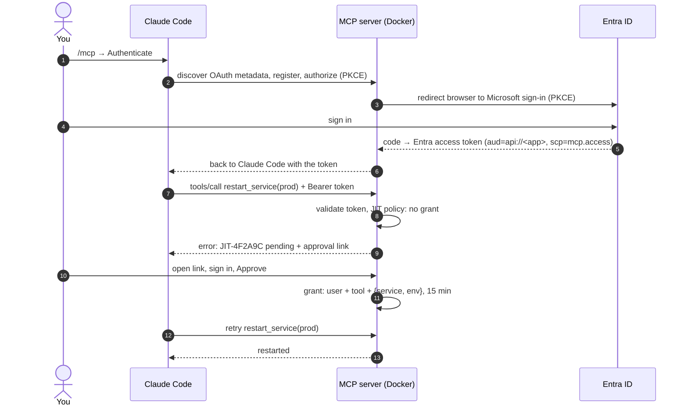

# MCP + Entra ID OAuth 2.0 + Just-in-Time authorization

A small, runnable demo of how to put **just-in-time (JIT) approval** in front of privileged MCP tools,
with **Microsoft Entra ID** for sign-in, used from **Claude Code**.

- **OAuth 2.0 answers "who is calling?"** Claude Code sends an Entra ID access token. The MCP server
  checks signature, issuer, tenant, audience and the `mcp.access` scope on every request.
- **JIT answers "may this person do *this* right now?"** Privileged tool calls are blocked until a
  human approves that exact action on a web page, after signing in with Entra ID. The grant is
  pinned to the user, the tool and its arguments, expires on its own, and can be revoked.

No standing access: a valid token alone can read, but cannot restart prod.

```
> restart the payments service in prod, it's leaking memory

● jit-mcp - restart_service (service: "payments", env: "prod", reason: "memory leak")
  ⎿ Error: JIT approval required. Nothing was changed.
    Request: JIT-4F2A9C (pending)
    Approve: http://localhost:8000/jit/JIT-4F2A9C
    Grant:   lasts 15 min after approval and covers only service=payments, env=prod.

● Prod restarts need just-in-time approval. Open the link, approve, and tell me when it's done.

> approved

● jit-mcp - restart_service (service: "payments", env: "prod")
  ⎿ {"result": "payments (prod) restarted", "by": "Ke Wang", "jit_request": "JIT-4F2A9C", ...}
```

## How it works



More detail: [docs/architecture.md](docs/architecture.md).

## What's in the box

| Path | What it is |
|---|---|
| `app/entra.py` | Entra access-token and ID-token validation (JWKS, v1 + v2 tokens) |
| `app/jit.py` | JIT engine: policy check, requests, grants, approve / deny / revoke, expiry |
| `app/server.py` | MCP server (Streamable HTTP, MCP Python SDK 2.x) and its tools |
| `app/web.py` | Approval page with Entra sign-in (public client, auth code + PKCE, no secret) |
| `policy.yaml` | Which tools need JIT, grant length, argument binding, approval mode |
| `app/oauth_proxy.py` | OAuth authorization server for MCP clients, proxying sign-in to Entra |
| `scripts/` | Create the Entra app, start the container, smoke test, CLI token helpers |
| `tests/` | 24 tests against a mock Entra ID, end to end over real HTTP, including the Claude Code sign-in |

Tools exposed to the agent:

| Tool | JIT |
|---|---|
| `whoami`, `list_services`, `get_service_status` | No (read-only) |
| `restart_service` | In prod |
| `scale_service` | In prod |
| `rotate_secret` | Always, single use |
| `check_jit_request`, `list_my_jit_grants` | No |

The "infrastructure" is a fake inventory in SQLite, so the demo is safe to run anywhere.

## Quick start

Needs Docker and Claude Code. One Entra app registration (see [docs/entra-setup.md](docs/entra-setup.md);
`scripts/create-entra-app.sh` does it with the Azure CLI).

```bash
git clone https://github.com/kxw9298/mcp-jit-entra-demo.git && cd mcp-jit-entra-demo
scripts/up.sh <tenant-id> <client-id>      # writes .env, builds the image, starts the container
claude                                     # the repo's .mcp.json points Claude Code at http://localhost:8000/mcp
```

In Claude Code run `/mcp`, pick **jit-mcp → Authenticate**. Your browser opens the Microsoft sign-in
page; after you sign in it returns to Claude Code. Then try *"who am I on jit-mcp?"* and
*"restart payments in prod"*.

Outside this repo: `claude mcp add --transport http jit-mcp http://localhost:8000/mcp`.

Step-by-step walkthrough for a live demo: [docs/demo-script.md](docs/demo-script.md).

## How Claude Code signs in

The MCP spec has the client send `resource=<MCP server URL>` (RFC 8707) to the authorization server.
Entra ID only accepts its own `api://...` identifier there and fails with `AADSTS9010010`
([issue](https://claudeissues.com/issue/89438-mcp-oauth-against-microsoft-entra-id-aadsts9010010-on-connect-aadsts650053-on-re)).
So this server is Claude Code's authorization server and Entra does the actual login
([app/oauth_proxy.py](app/oauth_proxy.py)):

1. Claude Code discovers the server's OAuth metadata, registers itself (dynamic client registration) and starts auth code + PKCE.
2. The server sends the browser to Entra (its own auth code + PKCE, public client, no secret, no `resource` parameter).
3. Entra redirects back to the server, which redeems the code and returns Claude Code to its loopback callback.
4. Claude Code receives the **real Entra access token** (`aud=api://<app>`, `scp=mcp.access`); the server validates it exactly as before.
   Entra's refresh token stays on the server; Claude Code gets an opaque, rotating handle.

## Policy

```yaml
approval_mode: self          # or two_person: someone else must approve
approvers: []                # optional allow-list of approver usernames
request_expiry_minutes: 30
reauth_minutes: 10           # approver must have signed in recently, else sign in again

tools:
  restart_service:
    jit_when: { env: [prod] }
    ttl_minutes: 15
    bind_args: [service, env]
  rotate_secret:
    jit_when: always
    ttl_minutes: 5
    bind_args: [service, env]
    single_use: true
```

`policy.yaml` is mounted into the container; run `docker compose restart` after editing it.

## Tests

```bash
pip install -r requirements-dev.txt
pytest -q
```

The tests start a mock Entra ID (JWKS, authorize and token endpoints with PKCE) and the real server
on local ports, then drive it with the MCP Python client and an HTTP "browser". They cover token
rejection (audience, tenant, expiry, signature, scope), the full request → approve → retry flow,
argument binding, revocation, single-use grants, denial, the two-person rule, CSRF, and forced
re-authentication before approval.

## Docs

- [docs/architecture.md](docs/architecture.md): components, token checks, JIT data model
- [docs/entra-setup.md](docs/entra-setup.md): app registration in the portal, by hand
- [docs/demo-script.md](docs/demo-script.md): a 10-minute live demo
- [docs/security-notes.md](docs/security-notes.md): what this demo does and doesn't protect against, and how to harden it

## License

MIT
