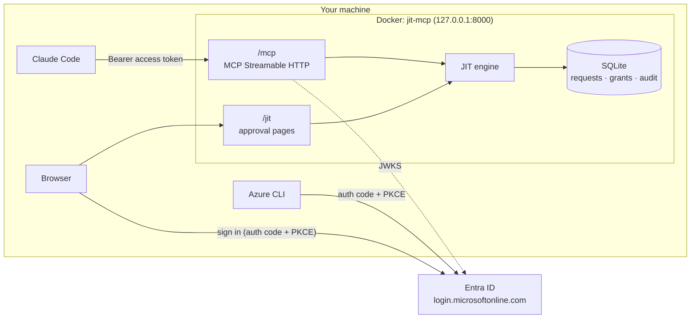

# Architecture

One container serves both the MCP endpoint and the approval pages. They share the JIT engine and
the SQLite file on the `jit-data` volume.

## Two layers, two questions

| Layer | Question | Where | Fails with |
|---|---|---|---|
| OAuth 2.0 (Entra ID) | Who is calling, and is the token meant for this server? | `app/entra.py`, MCP SDK bearer middleware | HTTP 401 / 403 |
| JIT authorization | May this person run this exact action right now? | `app/jit.py`, called from each privileged tool | Tool error with an approval link |

They are deliberately separate. A token is valid for an hour and can't be revoked mid-flight; a JIT
grant is checked on every call and can be ended at any moment.

## Access-token checks (every MCP request)

1. `Authorization: Bearer` present, else **401** with
   `WWW-Authenticate: Bearer ..., resource_metadata="<base>/.well-known/oauth-protected-resource/mcp"`.
2. Signature verified against the tenant's JWKS (`/discovery/v2.0/keys`, cached).
3. `iss` is this tenant (v1 `https://sts.windows.net/<tid>/` or v2 `.../<tid>/v2.0`), and `tid` matches.
4. `aud` is this API (`api://<client-id>` for v1 tokens, `<client-id>` for v2).
5. `exp` in the future (60 s leeway).
6. `scp` present (a delegated user token; app-only tokens are refused) and contains `mcp.access`,
   else **403** `insufficient_scope`.

The token is never passed on to anything else. The user identity used for JIT is the token's `oid`.

## JIT data model

A **request** is created when a privileged call has no grant:

| Field | Meaning |
|---|---|
| `requester_oid` | Entra object ID from the access token |
| `tool`, `bound` | Tool name and the arguments the grant is pinned to (`bind_args` in policy) |
| `fingerprint` | SHA-256 of tool + bound arguments; the lookup key |
| `justification` | The free-text `reason` argument, shown to the approver, not part of the binding |
| `status` | `pending` → `approved` / `denied` / `expired`; `approved` → `revoked` / `expired` / `used` |
| `grant_expires_at` | Set on approval: now + `ttl_minutes` |

A **grant** is simply an `approved` request whose `grant_expires_at` is in the future. On each
privileged call the engine:

1. Sweeps anything past its expiry to `expired` (and audits it).
2. Looks for an active grant for `(oid, tool, fingerprint)` → run, count the use, mark `used` if single-use.
3. Else reuses an existing pending request for the same key, or creates one → tool error with the link.

Retrying before approval doesn't create duplicate requests, and a grant for `payments/prod` does
nothing for `orders/prod` or for another user.

## Approval page

- Sign-in is a public-client authorization code flow with PKCE, `state` and `nonce`. No client
  secret exists anywhere. The redirect URI is registered under *Mobile and desktop applications*.
- The ID token is validated (signature, issuer, audience = client ID, tenant, nonce).
- Approve / deny / revoke are POST forms with a per-session CSRF token.
- **Freshness:** approving requires a sign-in within `reauth_minutes`; otherwise the page sends the
  approver back to Entra with `prompt=login` first.
- **Two-person mode:** the requester can't approve their own request (checked on the server, not
  just hidden in the UI). An optional `approvers` allow-list limits who may approve.
- Revoking only removes access, so any signed-in user may do it.

## Audit log

Every decision and execution is written to the `audit` table and to stdout as JSON
(`docker compose logs -f`): `jit.request_created`, `web.signed_in`, `jit.approved`,
`jit.approval_blocked`, `jit.denied`, `jit.grant_used`, `tool.executed`, `jit.revoked`,
`jit.grant_expired`, `jit.request_expired`. The dashboard at `/jit` shows the latest 40.
